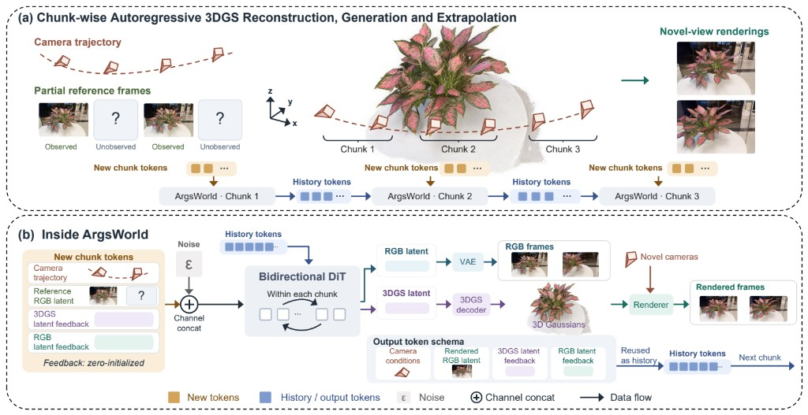

<p align="center">
  <h1 align="center"><em>ArgsWorld: Unifying 3DGS Scene Reconstruction, Generation and Extrapolation with Autoregressive Diffusion Transformer</em></h1>

  <p align="center">
    <a href="https://m4a1tastegood.github.io/ArgsWorld/"></a>
    <a href="https://huggingface.co/M4A1TasteGood/ArgsWorld"></a>
  </p>

  <p align="center">
    
  </p>
</p>

***TL;DR:*** ArgsWorld unifies 3DGS scene **reconstruction**, **generation**, and **extrapolation** in one autoregressive diffusion transformer. From posed images, an image or text prompt, and a camera trajectory, it predicts new views and an explicit, renderable 3D Gaussian scene.

## Demo

https://github.com/user-attachments/assets/ad9ea8ae-9fef-4ba8-9f15-ffd43dc13c13

## Setup

Use Linux, Python 3.11 or 3.12, and an NVIDIA GPU with BF16 support. Install the [CUDA builds of PyTorch and torchvision](https://pytorch.org/get-started/locally/), then install the remaining dependencies from the repository root:

```bash
python -m pip install -r requirements.txt
```

Download the ArgsWorld checkpoint from [Hugging Face](https://huggingface.co/M4A1TasteGood/ArgsWorld) and obtain the Wan2.2-TI2V-5B-Diffusers base model. Place them under `weights/`, or pass their actual paths in the commands below. The checkpoint path can point to a file or to a directory containing `model.ckpt`.

## Inference

The entry point accepts a task mode, a directory containing inputs, an output directory, and the model paths. The included example contains frames and the corresponding camera trajectory from a RealEstate10K scene. All three modes use the same autoregressive model; reconstruction is conditioned generation rather than a separate optimization procedure.

### Reconstruction

Reconstruct a scene from at least two views of the same scene and their camera trajectory. This example uses the 24 cameras in `trajectory.json`:

```bash
python infer.py --mode reconstruction \
  --model_id weights/Wan2.2-TI2V-5B-Diffusers \
  --ckpt weights/argsworld.ckpt \
  --input_dir examples --output_dir outputs/reconstruction \
  --images images/0000.png images/0003.png --reference_indices 0 3
```

The reference indices match the two images to camera slots 0 and 3 in the first trajectory segment.

### Generation

Generate 24 views from a single reference image, the `text_prompt`, and the 24 cameras in the included trajectory:

```bash
python infer.py --mode generation \
  --model_id weights/Wan2.2-TI2V-5B-Diffusers \
  --ckpt weights/argsworld.ckpt \
  --input_dir examples --output_dir outputs/generation \
  --trajectory trajectory.json --images reference.png
```

Generation also supports multiple reference images or no reference image.

### Extrapolation

Generate 24 views from one image along the first trajectory, then extend the scene by another 24 views along the second trajectory. The two included JSON files contain 24 ordered cameras each from the same RealEstate10K scene, for 48 views in total:

```bash
python infer.py --mode extrapolation \
  --model_id weights/Wan2.2-TI2V-5B-Diffusers \
  --ckpt weights/argsworld.ckpt \
  --input_dir examples --output_dir outputs/extrapolation \
  --trajectory trajectory.json trajectory_extend.json --images reference.png
```

Each file starts a new segment. The first segment's cameras determine the session's coordinate frame and scale; subsequent segments reuse them. You can also supply a single trajectory with more than 24 cameras, or use multiple reference images. Generation uses one segment of at most 24 cameras; extrapolation extends beyond the first 24-camera chunk.

### Input format

The input directory defaults to a trajectory file named `trajectory.json`. Paths passed to `--trajectory` and `--images` are relative to `--input_dir` unless absolute. The trajectory can instead specify `image_prompt` or `image_prompts` with image paths relative to its own location; `--images` takes precedence. Optional `--reference_indices` map up to eight images to zero-based camera slots in the first chunk (up to 24 cameras); without them, images occupy the first slots in order.

Each trajectory JSON contains a `cameras` list in generation order. Each entry gives OpenGL camera-to-world `quaternion` in `[w, x, y, z]` order, camera-center `position` in `[x, y, z]` order, and pixel intrinsics `fx`, `fy`, `cx`, `cy`. Provide `width` and `height` for the raster in which the camera was calibrated. The first trajectory may also provide a `text_prompt`. See `examples/trajectory.json` for the format. Multi-image references must correspond to their selected camera slots.

Outputs include `final_world.mp4` (rendered Gaussian scene), `direct_rgb.mp4` (direct RGB predictions), `world.ply` (3D Gaussians), `session_cameras.pt`, and, when references are used, `reference_views.jpg`. Videos are saved at 8 fps. Use `python infer.py --help` to list the supported options.

For advanced inference options, including session continuation and additional query views, use `python infer_ar.py --help`.

## Acknowledgements
We acknowledge the following open-source projects for their contributions and references to the field:
- [FlashWorld](https://github.com/imlixinyang/FlashWorld)
- [BiWM](https://github.com/LynnReal-AI/BiWM)
